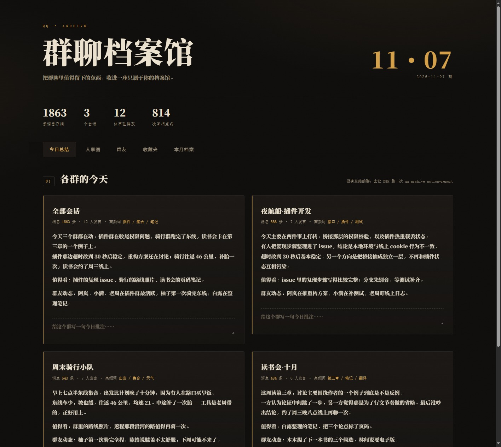
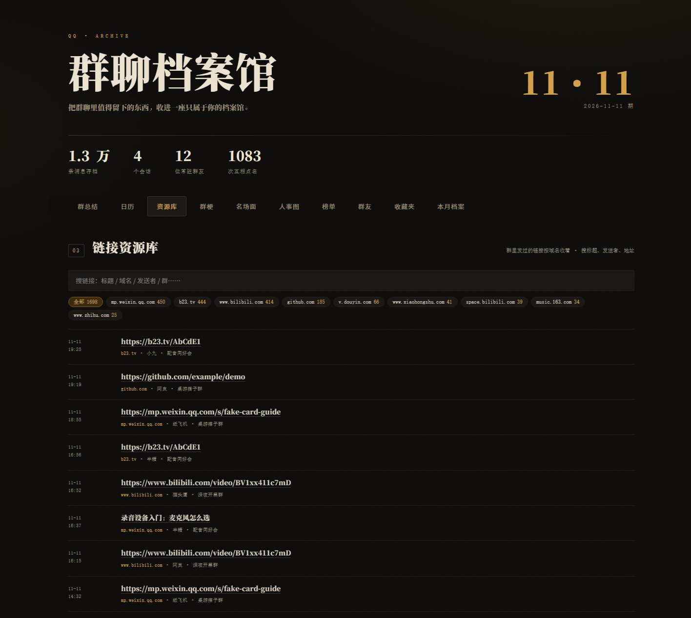
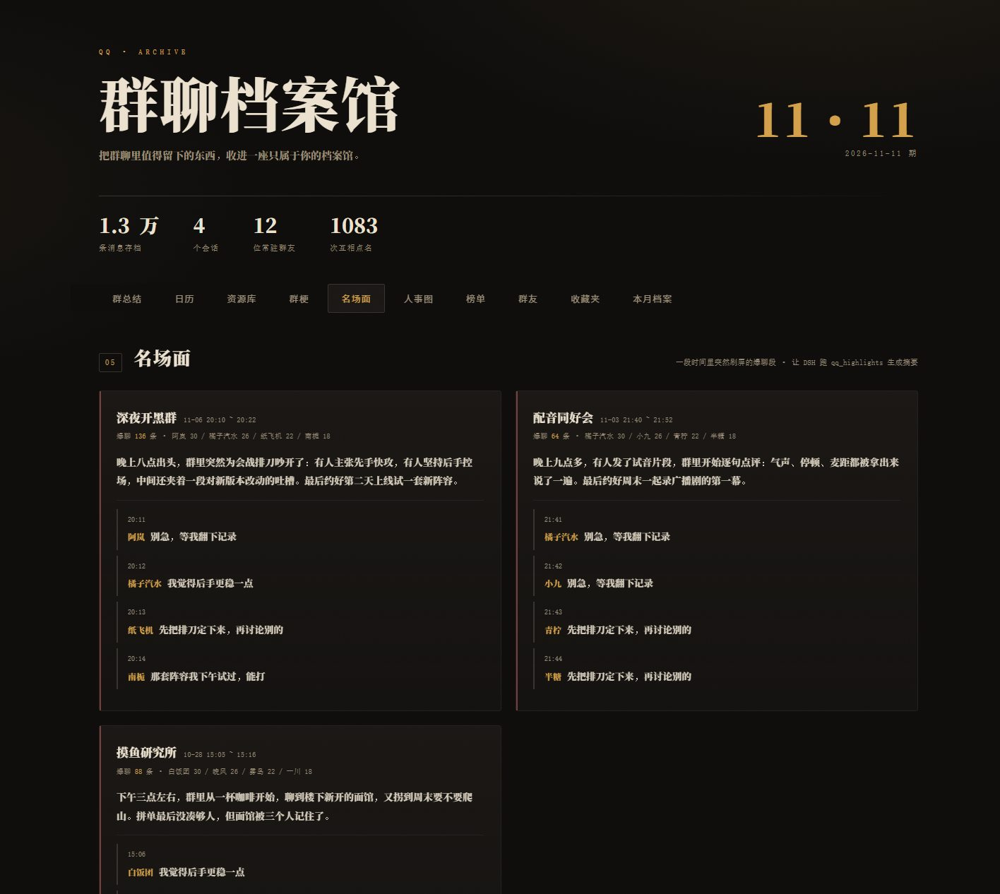
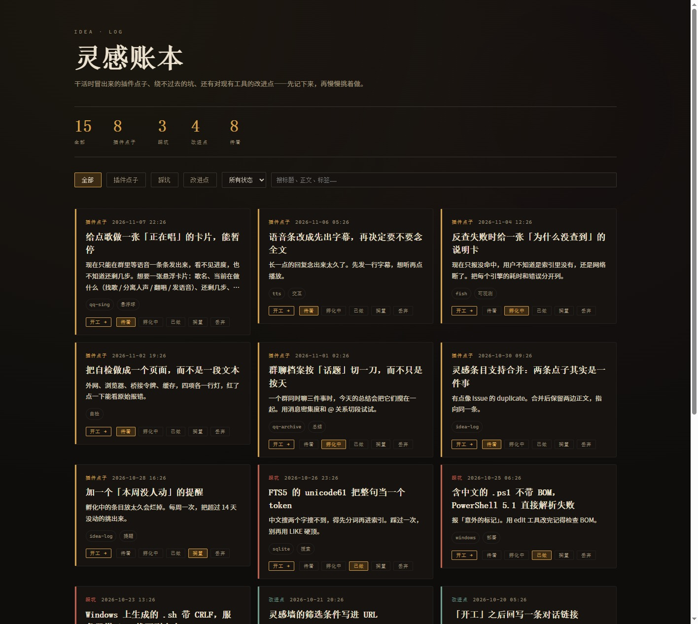
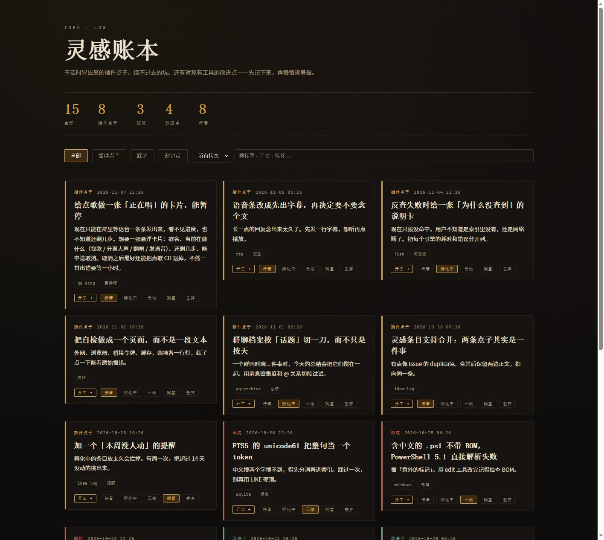

# dsh-lab

给 [DeepSeek Harness](https://github.com/deepseek-ai)（下称 DSH）写的插件与本地 MCP 服务合集。

不是示例代码，也不是 demo：这十三个项目都在一台 Windows 机器上真实跑着——群里有人点歌它真的会唱，发一张图它真的会去反查，说一句「画个……」它真的会在本机显卡上画出图，三个月前的那句话也真的能翻出来，桌面右下角那颗球真的能掐掉正在唱的歌，Pixiv / B 站的 MCP 每天都在被智能体调用。这里放的是能在自己机器上复现的那部分源码。

> 2026 年 9–11 月，围绕「让智能体真的能干活」做的一批东西。

改动记录见 [CHANGELOG.md](CHANGELOG.md)：按日期归并，最新在上，从建库（2026-11-07）写到上一次提交。

---

## 一览

| 项目 | 做什么 | 关键实现 |
| --- | --- | --- |
| [dsh-qq-sing](plugins/dsh-qq-sing) | 群友点歌 → B 站取源 → UVR5 分离人声 → RVC 翻唱 → 按静音切段 → 一条条语音发群 | detached worker、FFmpeg、RVC、QQ 桥 |
| [dsh-coser-fish](plugins/dsh-coser-fish) | 一张图反查 coser 的推特 / 微博 / B站 / Instagram / Pixiv | 8 个识图引擎、无头浏览器、名字二次外搜 |
| [dsh-qq-voice](plugins/dsh-qq-voice) | 让智能体用本机音色（GPT-SoVITS）发真正的 QQ 语音条 | GPT-SoVITS、qq-bridge 限流 |
| [dsh-self-extend](plugins/dsh-self-extend) | 能力缺口 → 检索 6900+ 插件目录 → 直接安装或生成骨架 | 插件目录、plugin_manager |
| [dsh-adb-phone](plugins/dsh-adb-phone) | 用 adb 操作一台真手机：截图 / UI 树 / 点击 / 输入 / 按键 / 应用 | adb、ADBKeyboard（中文输入） |
| [dsh-qq-archive](plugins/dsh-qq-archive) | 把群聊历史落成本地索引：全文搜、群友档案、群聊日报/周报/月报、@ 关系看板、自然语言问答、活跃日历、链接资源库、群梗考古、名场面、活跃榜、日报主动推送、给 QQ 桥的熟人卡 | SQLite + 分词/单字倒排、只读源库、单文件看板、在线查询 API、headless 截图 |
| [dsh-idea-log](plugins/dsh-idea-log) | 干活时随手记插件点子 / 踩坑 / 改进点，每天半夜自动从会话里提炼，侧栏一面墙，点「开工」直接开新对话 | 多帧 zstd 解压、模型提炼去重、postMessage + `uiWorkspace.startSession` |
| [dsh-fish-paint](plugins/dsh-fish-paint) | 一句自然语言 → 本机 SDXL 出二次元插画 / 表情包（点名角色先查 P 站对齐设定），落盘存元数据，要的话直接发 QQ | diffusers 常驻 worker、双模型（Illustrious-XL-v2.0 / WAI-NSFW）、rating sidecar 硬闸、一人 1 小时限流（VIP 不限）、qq-bridge 投递、GPU 令牌 |
| [dsh-floatball](plugins/dsh-floatball) | 桌面常驻一颗球：点开就是点歌 / 画画的监视与控制台，球挂在上层随时能掐歌、中止在画的那张、看显卡被谁占着 | Electron helper（自带运行时、透明置顶窗口、跨屏拖动按光标跟手）、本机 HTTP 控制口 + token、父进程探活 |
| [dsh-gpu-queue](plugins/dsh-gpu-queue) | 画画 / 唱歌 / 语音合成共用一块显卡：一次只放一个上卡，轮到唱歌先把画画的 worker 让出去 | 单通道 FIFO、心跳与进程探活回收、让位握手（`/paint/yield`）、本机 token 鉴权 |
| [mcp/pixiv-duty](mcp/pixiv-duty) | Pixiv App API 的 MCP：搜索 / 详情 / 下载 / 小说分段 / 校验 | pixivpy、FastMCP |
| [mcp/bili-duty](mcp/bili-duty) | B 站 MCP 的加固分支：30 个工具，登录 / 搜索 / 评论 / 字幕 / 私信 / 投稿 | bilibili-api-python |

十三个项目、64 个测试文件（56 个 `*.test.mjs` + 3 个 python 测试 + 5 个测试辅助脚本）。**仓库里没有任何账号凭证**（token / cookie / 密码一律走运行目录里的 `credential.json`，已被 `.gitignore` 排除）；模型权重、venv、出图产物也不入库（`**/data/`）。

> `dsh-llm-refusal-fix`（拒答 / 终止原因补丁）已迁移到独立仓库：<https://github.com/3438278672-ops/dsh-llm-refusal-fix>，本仓库不再保留副本。

---

## 界面

两个插件会自己画页面。截图都是用假数据跑的，细节在各自的 README 里。

**群聊档案馆**（`qq_archive action=dashboard` 生成的单文件看板，10 个栏目）：

<p>
  
  
</p>
<p>
  
  
</p>
<p>
  
  
</p>

**灵感账本**（DSH 侧栏里打开的灵感墙）：

<p>
  
  
</p>
<p>
  
</p>

**鱼鱼画画**（本机 RTX 3070 8G 用 `draw_image` 实拍，缩成 JPG 放仓库）：

<p>
  
  
  
  
</p>

---

## 六个设计故事

### 1. 点歌：按「静音」切，而不是按时间切

QQ 语音有条数限流（桥里默认 3 条/分钟），一首 5 分钟的歌不可能塞进一条。天真的做法是每 60 秒切一刀——但刀口落在字中间，听感立刻碎掉。

`dsh-qq-sing` 的做法是**先混完整首，再找人声的静音处下刀**：0.35 秒以上的静音才算边界，目标段长 48 秒、最长 56 秒；段与段之间电平一致（整首一次混音，人声 1.15 / 伴奏 0.9 / `alimiter=limit=0.89`）。发的时候严格 31 秒一条，5 分钟的歌切 7 段左右，3–4 分钟发完。

另外两个踩出来的决定：

- **worker 必须 detached**。DSH 关掉、模型睡着，这首歌也要唱完——失败和唱完用桥的 `/api/test-send` 补一句人话。
- **长伴奏头尾会被掐掉**（首/尾静音 > 18 秒）。此时人声块、伴奏、切片必须对齐同一段：伴奏先 `-ss/-t` 裁成同一区间，切片用相对时间（`s-offset`）。否则整首错位，最后几段还会超出混音长度——2026-10-27《大鱼》第 6 段空文件就是这么来的。

排队与额度：同一时间只唱一首，忙了进 FIFO（最多 5 首），每人 1 小时限 1 首且**没唱成自动退还**；白名单里的人不计时。悬浮球（dsh-orb）每 5 秒拉一次只读端点 `http://127.0.0.1:31877/qqsing.json`，显示在唱 + 排单。

### 2. 以图找人：为什么默认只开两个引擎

`fish_find` 接了 8 个引擎，但默认只跑 **saucenao + tracemoe**（本机实测约 2 秒出结论）。原因很实际：

- **Google Lens 最准**，能直接抓到推特主页，但要外网 + headless 浏览器。本机直连 `lens.google.com` 不通，硬跑会卡 5 分钟以上。所以插件在开跑前先做 **4 秒 TCP 预检**，不通就跳过，并在结果末尾写明原因——不会把整次反查拖死。
- saucenao / tracemoe 索引的是**画作和动画截图**，coser 本人的主页基本不在里头。所以「只命中 pixiv」是常态，不是故障。

于是有了第二层：拿到 pixiv 作者名之后，再按名字去外网搜「<名字> Twitter 账号」「<名字> コスプレ twitter」「<名字> 微博 账号」，从结果里认 `x.com` / `weibo.com` / `space.bilibili.com` / `instagram.com` 链接。规矩是宁可少报也不瞎报——**标题或摘要里必须能看到那个名字**，否则当撞号丢弃；一律标 `confidence: "inferred"`，输出带「（推断，未核实）」。

其他：QQ 会话里引用一张图就能查（插件直接向本机 qq-bridge 取原图，不用先落盘）；同一张图 30 天内重复问走缓存（300 条上限），不重复烧 SauceNAO 的免费额度。

### 3. MCP 的闸门要开在注册层

Pixiv 和 B 站这两个 MCP 都支持 `PIXIV_MCP_TOOLS` / `BILI_MCP_TOOLS` 环境变量白名单。关键不在「提示词里劝模型别用」——而在**不在名单里的工具连 `tools/list` 都不出现**，模型那边等于根本不存在。这是代码里的 `tool()` 装饰器替身做的事。

同样统一的还有错误口径：任何失败都返回 `{ok:false, code, message}`，不向上抛协议异常，上层 JS 永远能拿到人话提示。以及——`stdout` 是 JSON-RPC 通道，所有调试输出必须走 `stderr` 或 `duty.log`。

### 4. 中文搜索：为什么不用 FTS5 了事

`dsh-qq-archive` 要在几万条群聊里搜「打牌」这种两个字的词。SQLite 的 FTS5 两条路都堵：`unicode61` 把整句当一个 token，搜词命中不了；`trigram` 要求至少三个字符，两个字直接无结果。而中文里最常搜的恰恰是两字词。

所以索引是自己搭的**两层**：`Intl.Segmenter` 分词建一份倒排，再单独建一份**单字倒排**。查询按四级降级——原文连续子串（单字倒排，能搜到词典外的词）→ 分词 AND → 分词 OR（按词覆盖率过滤）→ 单关键词模糊。查不到就明说查不到，不拿「的」凑数。

另外两个取舍：源库（SnowLuma 的 `messages.db`）**只读**，索引落在插件自己的 SQLite；媒体按 image / voice / video / forward / file / link 各是一个可过滤类型，而不是一串占位符——QQ 的图链带 rkey，大约一周就过期，所以只有同步之后新到的媒体能缓存，历史媒体标记失效、不反复重试。

看板是另一件事：`dashboard.html` 单文件离线、双击就开，探案板上一张照片是一个人、一根红线是一次 @。红线最开始每对关系都画，图很快糊成一团；后来收敛成装饰——每人最多两根，剩下的信息挪到点开后的线索卡里。

### 5. 一键开工：网页半边碰不到宿主服务

灵感墙是一个 iframe 页面（`/idea-log/`），它想做的事却是「开一个新对话」——那是 DSH 网页主体的能力，同源不同窗，页面里拿不到。

链路只能这么走：页面按钮 → `postMessage({type:'dsh-idea-log:start', id, prompt})` → 插件自己的网页半边 `lib/client.js` 收到后先验两件事（`e.origin === location.origin`、`e.source` 就是那个 iframe 的 `contentWindow`）→ 调 `uiWorkspace.startSession(undefined, { prompt, whenDraftExists: 'replace' })`，回 `started` / `start-failed`。5 秒没回执，页面自己提示「DSH 那边没回话」。

几个刻意的决定：任务书由 **Host** 生成（`lib/start.mjs`，页面只是转交），这样「按类型该给什么指令」只有一处真相；**只预填、不自动发送**，人还能改；两侧的协议常量由 `tests/start.test.mjs` 检查，改一边忘了另一边会红；已经是「孵化中」的条目不再给开工按钮（锁哪几种状态也只写在一处：`START_BLOCKED_STATUSES`），同一条不会反复开成几个对话。页面单独打开（没有父窗口）时退化成复制到剪贴板——不会假装成功。

### 6. 出图：8G 显存里，别让驱动替你决定

SDXL 整卡加载需要约 8.2GB，而 8G 卡上桌面常年占着 1.6-2GB。第一版 `full` 模式的教训是：显存不够时 Windows（WDDM）不会立刻报 OOM，而是把溢出的部分挪进系统内存，然后安静地 thrash——压测里一张 512² 图 600 秒没有输出，看起来像「卡死」，其实一直在跑。

`dsh-fish-paint` 改成两道显式判断：worker 加载前先算「模型字节 + 1600MiB 余量」，不够就抛 OOM 并按 `auto` 回退 `cpu_offload`；插件侧再开一个常驻 worker（第一次约 40 秒加载，之后一直热着，空闲 30 分钟自退），把每次出图省掉一次加载。代价是单卡只能串行，`draw_image` 的队列替用户排好。

发送侧的闸也一样——不维护第二份 R18 名单：每张图落盘时写 rating sidecar，发送前动态加载 qq-bridge 的 `r18-guard.js` 判定，模块缺失就 fail-closed 宁可不发。被拒时图还在本地，错误里写清楚是哪个会话、几张图。

---

## 一些数字

| 项目 | 数字 |
| --- | --- |
| 识图引擎 | 8 个（saucenao / lens / yandex / bing / baidu / google / iqdb / tracemoe） |
| 点歌 | 单曲上限 9 分钟 / 12 段；一条语音 31 秒；排单 5 首；CD 1 小时 |
| Pixiv MCP | App API 请求最小间隔 1.5 秒（账号级风控，token 被吊销不可恢复）；单次搜索 3 个查询 / 20 条 |
| B 站 MCP | 30 个工具；凭证原子写；风控 -412 不再伪装成「0 条评论」 |
| 插件目录 | 检索 6900+ 个 DSH 插件，标注本机已装状态 |
| 群聊档案 | 3 万条历史约 7 秒建完索引；中文检索 4 级降级；看板单文件、红线每人最多两根 |
| 灵感账本 | 每天 23:30 自动提炼一轮；24 小时同名去重；「开工」只预填不自动发送 |
| 鱼鱼画画 | Illustrious-XL-v2.0（6.6GB）；RTX 3070 8G 上 512² 12-19s / 1024² 37-58s / 1216×832 52s；一人 1 小时一次（VIP 不限）；74 个单测 |
| 悬浮球 | 96×96 的球 + 392×572 的面板；Electron 44.0.0 运行时约 250MB；展开后一次拿全点歌/画画/显卡三份快照 |
| 显卡队列 | 一次只发一个令牌；持有者 60 秒没心跳就回收；画画最多排队等 10 分钟 |
| 拒答补丁 | vendor 1 份 Messages adapter；9 个离线 fixture + 7 条真机冒烟；provider 路由名、设置命名空间都不变 |

---

## 快速开始

### 装 DSH 插件

```powershell
# 在 DSH 里执行（把路径换成你 clone 下来的位置）
plugin_manager action=install_bundle target="link:D:/path/to/dsh-lab/plugins/dsh-qq-sing"
# 装完重启 DSH 桌面端
```

每个插件目录都有自己的 `README.md`，写了依赖、配置项和自检方式。路径默认值来自开发机，换机器时用插件 `config` 覆盖即可。

### 挂 MCP

```yaml
# cordis.patch.yml（DSH profile 目录下）
- insert:
    - id: mcp-pixiv
      name: '@deepseek-ai/dsh-mcp-client'
      config:
        serverName: pixiv
        transport: stdio
        command: 'C:\Windows\System32\cmd.exe'
        args: ['/c', 'D:\path\to\pixiv-duty\run-mcp.cmd']
        toolCallTimeoutMs: 120000
```

Python 侧：

```bash
python -m venv .venv
.venv\Scripts\pip install -r requirements.txt
# 放入 credential.json（Pixiv: {"refresh_token": "..."}；B站: 扫码登录后自动生成）
```

---

## 目录

```
dsh-lab/
├─ CHANGELOG.md           # 更新说明（按日期，最新在上）
├─ docs/                  # 设计文档（specs/ 下一份一份的实现前设计）
├─ plugins/
│  ├─ dsh-qq-sing/        # 点歌翻唱（index/worker/queue/cooldown + python 管线 + 8 个测试）
│  ├─ dsh-coser-fish/     # 以图找人（引擎内核 + 插件层 + 上游 CLI）
│  ├─ dsh-qq-voice/       # 文字 → 本机音色语音条
│  ├─ dsh-self-extend/    # 插件自扩展闭环
│  ├─ dsh-adb-phone/      # adb 手机控制
│  ├─ dsh-qq-archive/     # 群聊档案馆（搜索内核 + 档案 + 日报/周报 + 看板 + 问答/日历/资源库 + 熟人卡）
│  ├─ dsh-idea-log/       # 灵感账本（随手记 + 每日提炼 + 灵感墙 + 一键开工）
│  ├─ dsh-fish-paint/     # 鱼鱼画画（diffusers 常驻 worker + 出图落盘 + QQ 投递 + 控制口）
│  ├─ dsh-gpu-queue/      # 显卡令牌服务（画画/唱歌/语音共用一个 8G 显存）
│  └─ dsh-floatball/      # 桌面悬浮球（Electron helper + 点歌/画画控制台）
└─ mcp/
   ├─ pixiv-duty/         # Pixiv MCP（px_* 7 个工具）
   └─ bili-duty/          # B 站 MCP（bili_* 30 个工具）
```

---

## License 与声明

- 本仓库**自有代码**：MIT，见 [LICENSE](LICENSE)。
- `mcp/bili-duty/mcp_server.py`：派生自 [AGI_Ananas/bilibili-mcp](https://github.com/AGI_Ananas/bilibili-mcp)（MIT），改动清单见文件头注释与 [NOTICE](mcp/bili-duty/NOTICE.md)。
- `plugins/dsh-coser-fish`：内核来自 `coser-image-search v1.0.0`（MIT，Copyright © 2026 小鲸鱼），插件层为适配 DSH / QQ 桥新增。
- `plugins/dsh-fish-paint`：代码 MIT；使用的 Illustrious-XL-v2.0 模型（CreativeML Open RAIL-M）**不随仓库分发**，由安装脚本从 ModelScope 下载。
- 仓库不含任何平台账号凭证。代码只做只读抓取与个人收藏用途；平台内容版权归各平台与原作者，使用时请遵守对应服务条款。
